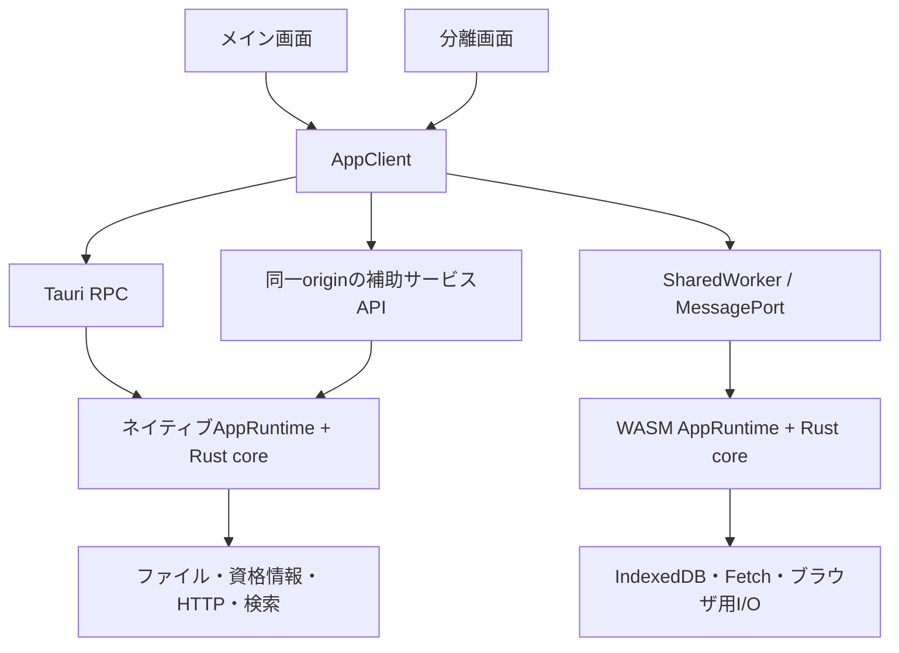

# ブラウザ共通UI・WASM対応アーキテクチャ

状態: 設計。実装・画面変更は未実施。

## 目的と決定

HTML + CSS + JavaScript ES Modules でUIを作り直す。デスクトップ専用UIのブラウザ向け模倣ではなく、同じ画面・操作・アプリケーション契約をTauriと通常のブラウザで利用する。

- 原稿、作品構成、設定資料、AIチャット、要約、メモ、ジャンル機能を維持する。
- パネルの分離・再結合を通常の操作として扱い、ブラウザでも別ウィンドウ／タブで利用できる。
- UIをRustのDOM描画から分離し、執筆ロジックをDOM非依存のRust coreに移す。coreをネイティブとWASMへビルドできる構成にする。
- WASMはOS権限やブラウザの通信制限を回避する手段ではない。完全なネイティブ機能が必要な場合の接続先を明示する。
- フレームワーク導入やNode/Viteへの変更は前提としない。既存のCargo/Trunkを基点に、共通の静的UIを配信する。

## 現状との境界

以下はコードで確認した現状であり、移行後の仕様と区別する。

- `frontend-rs/src/lib.rs` は `data-rust-window` により各画面のRust `mount` を呼ぶ。
- `windows/main_app/mod.rs` の `State` に作品・選択・本文・AI処理・分離状態が集約され、DOM用の状態とも結合している。
- `runtime/invoke.rs`、`runtime/tauri.rs`、`runtime/windows.rs` は `window.__TAURI__` に直接依存している。
- 分離画面との同期は `summary-sync`、`memo-sync`、`chat-sync` 等のTauriイベントで行う。メインの終了処理は保存、同期、他ウィンドウ破棄を行う。
- `runtime/ai.rs` のAI通信もTauri invoke/Channelに依存する。現在WASMへコンパイルされることと、通常のブラウザだけで動作することは同義ではない。
- `scripts/ui-preview/` のTauri fixtureは表示確認用であり、本設計のBrowser Hostとして流用しない。

## 共通UIと実行主体

### 責務

- **UI**: セマンティックHTML、CSS、DOM操作、入力、フォーカス、スクロール、ダイアログ。作品データや生成ジョブの正本にはならない。
- **AppClient**: コマンド送信、状態購読、初期snapshot取得。UIは直接Tauri invoke、WASM export、保存API、プロバイダーAPIを呼ばない。
- **AppRuntime**: 作品状態、変更revision、生成ジョブ、ツール実行、保存の所有者。画面数に関係なく、同じ保存領域には単一の書き込み主体を置く。
- **Rust core**: 作品操作、文脈構築、プロンプト、役割別モデル設定、生成・査読工程、ツール許可検証、hashline編集。DOM、`web_sys::Window`、Tauri、OSファイルパスへ依存させない。
- **Host Ports**: Repository、AI transport、検索、インポート／エクスポート、認証、同期。ネイティブ実装とブラウザ実装の差を閉じ込める。
- **WindowHost**: ウィンドウ生成・フォーカス・終了・位置などの環境差。表示上の役割であり、作品の正本やAIジョブを所有しない。

`src-tauri/src/context/` を現用coreとして一括採用しない。現用のフロント側文脈構築・生成経路から抽出する。共有可能なRust処理と環境依存I/Oを分け、既存バックエンド全体がそのままWASMになるとは仮定しない。

### 実行形態

| 形態 | AppRuntimeの所在 | 保存とネイティブ機能 |
| --- | --- | --- |
| Tauri | アプリプロセス内のネイティブRust | 現行の作品ファイル、OS資格情報、検索、HTTP、同期を維持 |
| ブラウザ＋ローカル補助サービス | 補助サービス内の同じネイティブRust | UIとAPIを同一originで配信し、既存データ・認証・通信機能を利用 |
| ブラウザ単独＋WASM | 同一originのSharedWorker | IndexedDBとブラウザAPI。外部接続は対象サービスがブラウザ利用を許可する範囲 |

同一の作品をネイティブruntimeとWASM runtimeが同時に所有しない。起動時に利用するruntimeと保存領域を確定する。接続不能時に別の空データベースへ黙って切り替えない。

ローカル補助サービスは将来の実装対象であり、現在存在するサーバーではない。Tauri専用部分からサービス処理を分離して再利用し、Tauriコマンド全体を任意実行できるHTTP APIにはしない。外部クラウドや公開プロキシの利用を前提にしない。

## AppClientの契約

Rustのserde型を正とし、JSは同じスキーマを利用する。UI側に別の業務ルールやプロンプトを複製しない。

- `connect`: protocolVersion、runtimeId、利用可能機能、初期snapshotを返す。
- `dispatch`: requestId、workspaceId、対象ID、必要なexpectedRevision、コマンドと引数を渡す。結果または型付きエラーを返す。
- `subscribe`: 必要な作品・画面の状態とジョブイベントを購読し、解除関数を返す。
- `snapshot`: 再接続や状態イベントの欠落時に正本を再取得する。
- 生成の開始・停止も同じコマンド契約に含める。実装別の停止ボタンや別ジョブは作らない。

実行失敗、権限不足、競合、保存容量不足、接続断を区別する。無応答や接続断を成功として表示しない。応答不明の生成・編集を自動再送しない。requestIdにより二重クリックや重複配送による副作用の重複を防ぐ。

文書更新は保存結果とrevisionを対応付ける。「保存済み」はRepositoryのcommit完了後に表示し、生成進捗の受信を保存完了として扱わない。生成中の通信待ちで他の画面操作や停止要求をブロックしない。

## 分離ウィンドウの契約

### 同じパネルを別の場所へ表示する

チャット、要約、エピソードメモ、設定資料、プロジェクトメモを対象とする。ジャンルライブラリ／ジャンルチャットも同じAppClientとWindowHostを利用し、ジャンルIDで対象を区別する。

- dockedとdetachedは同じパネル実装を使う。専用の機能劣化版を作らない。
- パネルIDはworkspace、対象、パネル種別で識別する。同じパネルを再要求した場合は既存画面へフォーカスする。
- 分離状態は `docked → opening → detached → docking → docked`。開けなかった場合は `opening → docked` に戻る。
- 子画面の接続・snapshot受信・描画準備完了後に元パネルを隠す。開く前に消して空白を残さない。
- 再結合も転送先の準備完了後に表示場所を切り替える。途中で双方が書き込みを所有しない。
- 作品／エピソードの選択変更は共有状態から反映する。分離時点のIDを閉じ込めて古い対象へ書き続けない。
- 未送信チャット、編集途中の入力、選択範囲、スクロール、編集履歴を引き継ぐ。DOMを破棄して入力を失う設計にしない。
- 更新を受けても入力中の要素全体を再生成しない。日本語IMEのcomposition、キャレット、フォーカスを維持する。

### ブラウザでの生成と復元

`WindowHost.requestDetach` はユーザー操作の同期ハンドラー内で `window.open` を実行する。WASM初期化、保存、RPCなどをawaitしてから開かない。その後の接続準備は非同期で行う。

- `popup` は要求であって保証ではない。ブラウザがタブとして開いても同じ機能を提供する。
- ポップアップが拒否されたら元パネルを維持し、理由と再操作方法を表示する。
- 起動時に複数画面を自動で開かない。前回の分離配置を示し、ユーザー操作ごとに復元する。
- 位置・サイズはブラウザが許す範囲で扱う。任意のモニターへの配置やピクセル単位の復元を保証しない。
- `window.opener` の有無をAppClientの接続条件にしない。URLには対象IDだけを載せ、本文や資格情報を入れない。
- 内部パネルは同一originに限定する。外部リンクは分離画面の接続経路に使わず、openerを与えない。
- 閉じる／再読み込み／接続断を扱い、パネルの再接続時は最新snapshotと未反映の入力を照合する。

### 実行主体の寿命

ブラウザ単独版では、同じorigin・固定worker URL/nameのSharedWorkerを全画面で共有する。画面ごとにWASM実行主体を生成しない。異なるアプリ版のworkerが同じ保存領域へ並行書き込みしないよう、protocolと保存schemaを照合し、不一致時は再読込／更新待ちとする。

メイン画面を閉じても分離画面が接続していれば操作を継続できる。全画面が閉じた後の実行継続は保証しない。`beforeunload` やworkerの終了猶予を唯一の保存契機にしない。ブラウザ自体が停止・破棄した場合は、最後にcommitされた状態から復旧する。

Tauri版の実行主体はウィンドウではなくアプリプロセスに置く。通常のウィンドウ終了と「アプリ終了」を区別し、メインを閉じただけで残る画面の実行主体を破棄しない。明示的な全体終了は保存とジョブ終了を確認する。

SharedWorker、WASM、IndexedDBをブラウザ単独版の必要条件とする。未対応環境で各画面を独立した書き込み主体に切り替える互換処理は作らない。対応ブラウザ／WebViewは実機検証結果で明示する。

### 状態配送

ブラウザ単独版はMessagePort、TauriはIPC、補助サービス版は同一originの要求／イベントAPIを使う。BroadcastChannelは正本や排他制御に使わない。

イベントはruntimeId、対象、revisionまたはジョブ内sequenceを持つ。重複や過去の状態を適用せず、欠落時はsnapshotを取得する。購読開始とsnapshot取得は同じruntimeで整合させ、初期接続中の変更も欠落させない。

生成テキストは差分を送り、画面側でフレーム単位に描画する。各tokenで全文・全履歴を全画面へ複製しない。非表示パネルには不要な購読を行わない。資格情報は状態イベントに含めない。

## 保存・検索・通信

### 作品データ

- ネイティブ側の `Documents/litra/projects`、`genres` とMarkdown/JSONの意味を維持する。UI変更を理由に既存データを破壊的変換しない。
- ブラウザ単独版ではIndexedDBを正本とし、作品データ・revision・編集結果の対応をtransactionで保存する。本文をlocalStorageへ保存しない。
- Repositoryの論理データモデルを共通にし、作品・ジャンル全体を既存のディレクトリ構造へエクスポート／再インポートできるようにする。
- フォルダ取り込みはブラウザのファイル選択と相対パスを利用する。フォルダアクセスAPIを利用できない環境にも、アーカイブ等による全データの入出力経路を用意する。
- OSフォルダへの直接保存は権限と対応APIを確認する。ブラウザ内保存とOS上のファイル更新を同じ「保存先」と表示しない。
- IndexedDBも容量制限・削除・プライベートモードの影響を受ける。永続化許可の結果、保存失敗、エクスポート方法を明示し、バックアップ不要とは扱わない。
- データと再構築可能な検索インデックスを分ける。IndexedDBのindexを全文検索の代用品と見なさない。

### 全文検索と同期

既存の本文・要約検索およびジャンル検索をSearch Portへ分離する。ネイティブ／補助サービスでは現行Tantivyを利用する。Tantivyの現行依存がそのままWASMで使えることは未確認であり、ブラウザ単独版の移植検証項目とする。代替する場合も、検索対象、クエリ、結果フィールド、順位付けとsnippetの利用者向け挙動を比較し、単純な部分一致に黙って縮小しない。

WebDAVはSync Portへ分離する。起動時／手動のpull、push、保存後同期と失敗表示を維持する。ブラウザ終了時の非同期push完了は保証できないため、終了時だけに依存せず保存後・手動同期で確定させ、ローカル保存と同期済みを区別する。

### AI・Web取得・資格情報

- chat／writing／judgment／background、プロバイダー選択、モデルオプション、ストリームの状態遷移、停止、構造化出力、ツール許可を共通coreで維持する。
- ブラウザFetchでもWASMでもCORS、送信可能なヘッダー、HTTPSからの接続先制約は残る。WebDAV、Web取得、llama.cpp等も対象となる。
- ブラウザ直結は、対象サービスの認証とCORSを確認した接続先だけを対応済みとする。`no-cors` や架空応答で動作扱いにしない。
- ブラウザ単独で扱えない既存プロバイダー／OAuth／Web取得は、ネイティブ補助サービスを利用する経路を持つ。既存のlocalhost callbackやOS資格情報をブラウザ内で実行できるとは仮定しない。
- ブラウザ単独のAPIキーは既定でメモリー内のみ。OS資格情報と同等の保護があるとは説明しない。補助サービス利用時は秘密をサービス側で保持し、状態snapshotやログへ返さない。
- 補助サービスはloopback上でUIとAPIを同一origin配信し、Origin/Host検証、ローカルでの利用許可、セッション認証を行う。任意サイトからの呼び出しや任意URL中継を許可しない。起動ごとにoriginを黙って変更しない。
- 機能の利用条件はcapabilitiesで返す。利用可能、権限が必要、補助サービスが必要、未対応を区別し、できない操作を成功扱いにしない。

「既存の全接続先をブラウザ単独＋WASMだけで完全再現」とは約束しない。既存機能の維持は共通UIとネイティブ経路を含めて担保し、単独版の制約はリリース時に対応表で明示する。

## UI品質の基準

- 原稿を中心とし、作品ナビゲーションと補助パネルを整理する。旧3カラムや旧DOM IDの保存をデザイン上の制約にしない。
- 色、余白、文字組み、操作部品、アイコン、フォーカス、エラー表示を共通CSS tokensと部品で統一する。分離画面だけ別の規則を作らない。
- 素のHTML要素を基本にし、JSはES Modulesに分割する。`window`上の巨大な可変グローバルやHTML文字列への未処理データ挿入を避ける。
- Markdown／AI／取り込みデータの表示は既存のサニタイズ方針を維持する。ネイティブ・ブラウザ双方でCSPを設け、外部データを実行コードとして扱わない。
- キーボード操作、ショートカット、ダイアログのフォーカス復帰、IME、十分なコントラスト、reduced-motionを確認する。
- 空、読込中、生成中、停止中、保存失敗、接続断、機能の利用条件を画面設計に含める。色や無効ボタンだけで説明しない。
- 1440/1024/768/390pxと小さな分離画面を実際に表示し、原稿・チャット・設定の操作経路が失われないことを確認する。

## 移行の順序と完了条件

1. 現用のユーザー操作と保存形式を機能表にし、AppClientのコマンド／状態型を定義する。
2. 現用の生成・文脈・ツール・編集処理からDOMとTauri直接依存を分離し、共有Rust coreとネイティブAppRuntimeへ移す。
3. 共通HTML/CSS/JSでメイン画面と全補助画面を実装する。新旧の描画主体を同じ画面へ混在させない。
4. Tauriとブラウザ＋補助サービスで同じユーザー操作を照合する。単なるfixture表示をブラウザ製品版の検証としない。
5. coreのWASM entry、SharedWorker、ブラウザRepository／Host Portsを接続し、ブラウザ単独の操作・永続化・接続対応を検証する。
6. 全呼び出し元とテスト・ビルド・文書を更新し、旧Rust DOM描画、不要なHTML entry、inline Tauri bridgeを撤去する。恒久的な旧UI shimは残さない。

段階は移行作業の順序であって、機能を削ったまま移行完了とするための区分ではない。

### 操作による受け入れ条件

- 既存作品を開き、エピソードを作成・改名・並び替え・削除し、日本語本文を編集・保存・再読込できる。
- キャラクター、世界観、人間関係、要約、一行要約、エピソードメモ、プロジェクトメモを編集・再読込できる。
- チャットの送信／停止、役割別モデル設定、続き生成、選択範囲の書き直し、講評、要約、提案の適用が従来の意味を保つ。
- 許可されないツールは実行されず、hashline／expected_textとUTF-16選択境界の保護が残る。古いrevisionを使った編集で新しい本文を失わない。
- 本文・要約・ジャンル検索、フォルダ分類・取り込み、ジャンル分析・知識管理の操作結果を照合する。
- 作品／ジャンルのエクスポートを別環境で取り込み、本文と設定・履歴・資料の意味が保持される。
- 各対象パネルの分離・再結合・再読込・重複操作で、未送信入力や編集が失われず、二重生成・二重保存が起きない。
- 分離チャットから開始した生成を他画面から停止でき、全画面で同じジョブ状態が見える。
- メイン画面を閉じても残る分離画面で操作できる。全終了後は保存済みデータから復元できる。
- ポップアップ拒否、タブとしての生成、自動復元制限、権限拒否で元のパネルとデータが残る。
- 保存容量不足、通信断、同期失敗、runtime再接続、画面間の競合を実際に起こし、未保存内容と失敗理由が分かる。
- デスクトップとブラウザの操作感を実画面・キーボード・IME・スクリーンショットで確認する。ブラウザ間の差と未確認項目を記録する。
- API接続・OAuth・OS資格情報・同期はそれぞれ実際に検証した範囲だけを対応済みとする。モック試験やビルド成功で代用しない。
- Tauriから切り離したcoreがWASMへビルドでき、ブラウザで実行され、ネイティブ版と共有する操作契約を満たす。

## 設計時の検証範囲と参考資料

現用ソースの読み取り、cccによる依存境界の探索、以下のブラウザAPI資料との照合を実施した。この文書は実装完了や動作検証の報告ではなく、ビルド・テスト・実ブラウザ操作は行っていない。

- [Window.open: ユーザー操作、ポップアップ、戻り値](https://developer.mozilla.org/en-US/docs/Web/API/Window/open)
- [SharedWorker: 複数画面からの接続と寿命](https://developer.mozilla.org/en-US/docs/Web/API/SharedWorker)
- [Broadcast Channel: 同一origin／storage partitionの配送](https://developer.mozilla.org/en-US/docs/Web/API/Broadcast_Channel_API)
- [IndexedDB: transactionと全文検索の制約](https://developer.mozilla.org/en-US/docs/Web/API/IndexedDB_API/Basic_Terminology)
- [File System API: ユーザー権限とOPFS](https://developer.mozilla.org/en-US/docs/Web/API/File_System_API)
- [ブラウザ保存容量と削除条件](https://developer.mozilla.org/en-US/docs/Web/API/Storage_API/Storage_quotas_and_eviction_criteria)
- [CORS](https://developer.mozilla.org/en-US/docs/Web/HTTP/Guides/CORS)
